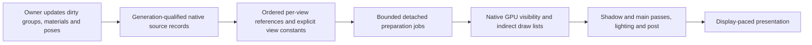

# Concrete route from the native fork to Apple-first render ownership

**Whole-engine integration underway,2026-11-14:** [active work](../work/active/apple-first-engine-integration-20261114.md) connects producer publications, main/probe/shadow consumers, bounded world jobs, poses and frame-wide streaming/probe admission. Native visibility remains cost-gated; no new combined runtime result or completion claim. The original acceptance gates below remain authoritative.

**Completion correction,2026-11-14:** the original G2–G5 architecture remains
**partially implemented**. A built/tested/staged experimental app was delivered,
with important dirty-producer publication, persistent GPU scene work and global
frame/resource admission missing. [Source/log audit](apple-first-architecture-audit-2026-11-14.md)
corrects the earlier broad completion label, records the16GiB pressure-policy
conflict and distinguishes the unexercised opaque path from unsupported hardware.
The whole-architecture performance and original live acceptance gates have not
passed; historical delivery statements below do not override this correction.

**Execution update 2026-11-13:** owner authorizes completing G2–G5 continuously,
then testing one combined app. The earlier per-goal runtime stopping points in
this historical route are superseded by the [active combined goal](../work/active/apple-first-architecture-g2-g5.md).
G1/crash-repair/profile checkout is preserved; implementation proceeds on the
isolated `codex/apple-first-architecture-g2-g5` branch. Runtime acceptance and
in-world performance remain future owner checks, not assumed results.

**Implementation/delivery update 2026-11-14:** [integrated G2–G5 candidate and measured choices](apple-first-architecture-g2-g5-results.md) is built and separately staged as26.4.0.68995 from local code/test pin `6baeb0340a1ddeb89aa265a1a64321ad1e0cd57a` (renderer implementation `d5ae05f2ffec7c243667d0414b5fc003a9164fb4`). Required build, corrected contained tests, native static/source/ABI/signature and exact-copy checks pass. The historical future-tense route below is retained, with accepted and rejected variants explained by the results. This does not claim a wholly GPU-owned viewer, observed scene speedup or release completion. Owner combined-app runtime assessment is next; no agent launch or push.

Baseline `18e576cec0a05923632188ec8d7b2224657ffbfa`, 2026-11-13.
Execution starts with [goal one](../work/active/apple-shadow-records-goal1.md).
At that historical checkpoint, [goal one's measured result](apple-shadow-records-goal1-results.md)
passed its headless gate, with single-use regression PPD-089 retained, and G2–G5
had not started. The execution updates above supersede that historical state.
The [source/evidence study](apple-first-renderer-architecture-2026-11-12.md)
contains hardware and profile evidence; this document retains the original
implementation route and conditional decisions. Consult the linked integrated
results for what is now implemented, enabled, rejected and still unverified.

## Current Second Life path and the ownership change

`LLVolumeGeometryManager::registerFace` populates retained
`LLSpatialGroup::mDrawMap` entries. Per-view `stateSort/postSort` rebuilds only
dirty geometry and produces `LLCullResult` maps. Sun cascades and projector
views then separately count sources, capture native batches and encode them.
The viewer already has retained scene data, GPU skinning, once-per-frame skin
palette computation, native buffer generations, frame arenas and ordered queues.

The missing boundary is an immutable native input that can outlive the mutable
scene walk. Presently native geometry/material/palette inputs are rediscovered
while each view is traversed. `gGL`, `sCull`, joint lazy updates and arena maps
prevent moving those calls wholesale to workers. The replacement is:

## Goal one: prove reusable pose ownership on real shadow submission

`LLVOAvatar::MatrixPaletteCache` is the generation boundary for attachment
palettes. Publish an owned immutable record when that cache changes; reuse it in
opaque, textured and PBR shadow batches and the shared native frame arena.
Eliminate repeated finite scans and byte hashing for that record while retaining
range/coverage checks and actual GPU completion protection. Body/cloth palettes
remain on their view-dependent path. No shader, shadow quality or pass change.

This provides a concrete production use of versioned input ownership and a
bounded baseline comparison. It does not yet parallelize the renderer or claim
that palette processing accounts for the entire measured shadow bottleneck.
Continue only after the declared mechanism gate and owner app assessment.

## Goal two: retain geometry/material sources and admit each view once

At group draw-map rebuild/resource-generation change, create native source
records for geometry/index stores, ranges, pipeline family, material/coverage and
texture classification. Reuse existing LLVB native generations; add explicit
material/publication epochs where missing. Texture pixels and their alpha/PBR
classification must publish coherently. Do not cache only a raw `LLDrawInfo*`.

Replace `countMetalShadowBatches` plus repeated source rediscovery with one
ordered admitted source list per view. Preserve the original pool completeness
contract, source counts, terrain/tree/body special paths, PBR alpha policy,
double-sided state and occlusion-query boundaries. Attach explicit view matrices
and current pose-record handles to stable sources. Start with attachments and
opaque sources; extend other families only with equivalent contracts/tests.

Gate: actual old/new admitted lists, coverage and GPU depth match for changes,
unload/rebuild, teleport/origin shifts and failures; full capture+encode CPU time
improves, retained bytes stay bounded, and the owner sees no scene regression.

Concrete edits for this goal, rather than a second scene engine:

| Existing owner | Proposed change |
|---|---|
| `LLVolumeGeometryManager::registerFace/rebuildGeom`, `LLSpatialGroup::mDrawMap` | Publish/retire native source records at the existing rebuild boundary; keep retained SL draw-info ownership. |
| `LLVertexBuffer::getContentStamp/prepareMetalBuffers` and native-store retirement | Qualify source geometry by content stamp and published store; add a lease that blocks reuse while detached CPU/encoder work exists. Current raw getters alone are insufficient. |
| Native texture/material publication and LLDrawInfo material fields | Publish a coherent material/coverage epoch and pinned native resources; invalidate from actual edits/streaming completion. |
| `sortShadow/countMetalShadowBatches/captureMetalShadowScene` | Produce one ordered admitted list with fixed family boundaries and completeness accounting, then resolve view constants/current pose handles. |
| `MetalWorldSimpleCapture` and `ALMetalWorldGBufferRenderer::renderSpotShadow` | Own the packet/leases and consume native source references; preserve current query offsets and failure transaction. |

These are proposed changes, not claims that an exposed store-generation lease
or material epoch already exists. Keep goal one's per-batch shared ownership
cost visible; aggregate unique record/resource pins at packet scope when goal
two makes that ownership boundary available.

## Goal three: detach useful CPU work from mutable viewer state

Owner resolves cull/scene/animation dependencies and publishes the immutable
input epoch. Jobs receive spans of source records, copied view constants and
pose handles, not live `LLDrawInfo`, avatar/joint getters, `gGL` or `sCull`.
Use bounded Dispatch jobs with worker-local scratch/output; merge by existing
source order on the owner. Start with substantial rigged-shadow chunks, keeping
single-owner arena/cache publication until those allocators are explicitly split.

CPU leases must protect storage from reuse as well as destruction while work is
queued or encoded but not committed. Submitted GPU leases end only on actual
completion. Canceled/late epochs release without publication. Bound ready work,
in-flight work and bytes globally with decode/upload workers; avoid six full
independent shadow traversals racing on the current globals.

Gate: serial/detached output and fault/cancel behavior match, CPU wall time and
frame-tail latency improve with all job/merge overhead included. Reject extra
queueing latency even when worker occupancy rises.

## Goal four: consume persistent records on the Apple GPU

Extend the existing native indirect-shadow work to persistent geometry/material
tables and GPU-produced visibility/compaction, including rigged and masked
families. Keep conservative bounds for moving attachments and view-specific body
inputs. Preserve query semantics and Second Life draw/alpha order where required;
indirect execution cannot reorder transparent content arbitrarily.

Use capability-tested native Metal 4 command allocators, argument tables and
residency where measured encoding/allocation cost justifies migration. Existing
terrain/water tessellation paths require an explicit supported plan rather than
a mechanical all-at-once API substitution. The existing Metal queue ordering
protects worker texture publication; any new queue needs explicit events/waits.
Gate each converted family against direct native execution for GPU output,
CPU+GPU time, lifetime, working set and latency. No Vulkan/translation layer.

## Goal five: finish unified-memory and frame scheduling work

Eliminate redundant staging for suitable dynamic LLVB inputs by publishing
immutable changed ranges into shared native storage; retain private GPU-heavy
textures/targets when their access pattern benefits. Shared physical memory does
not make mutable CPU/GPU races safe. Keep mappings, generations, dirty ranges,
CPU leases and GPU completion explicit; avoid duplicating a whole SL world per
frame. Preserve current IOSurface media ingress and asynchronous readbacks.

Use actual render-pass producer/consumer lifetimes to reduce unnecessary
load/store/intermediate traffic and select memoryless attachments where valid.
Tune shadow/main/light/post scheduling, presentation admission and in-flight
bounds together. Keep simulation, prepared snapshot, submitted work and presented
world identity distinct. GPU busy time alone is not the success metric.

Gate: paired same-quality busy/static/loading/turning/teleport scenes on M1 Max,
including frame-time tails, input latency, memory and stability, with the product
performance and feature-parity gates still authoritative. Later Apple Silicon
gets runtime capabilities and its own measured tuning. Network, inventory,
editing, UI, media and voice remain Alchemy functionality throughout.
