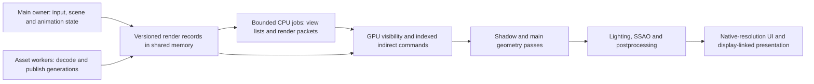

# Apple-first renderer architecture for this fork — 2026-11-12

## Recommendation

Evolve the existing native Metal fork around **persistent, generation-qualified
render data; bounded parallel CPU preparation; GPU-resident visibility/draw
execution; and a tile-aware, latency-controlled frame graph**. This targets the
repeated preparation/submission in the captures and establishes ownership that
supports efficient CPU scheduling, Metal 4 submission and GPU-produced work.

The current renderer is already native Metal. Its next architectural step is to
make the production and ownership of render work suit Apple silicon. Preserve
Alchemy's network, inventory, simulation, editing, UI and media behavior; change
the rendering/data-execution boundaries with explicit source-equivalent contracts.
This report is an investigation, not implementation authorization or a speedup
claim. No viewer source was changed, rebuilt or launched for it.

## Source, hardware and evidence

Source pin: `ef4290723c35dfcfb0149a9bbc55ca51fec227fb`, branch
`codex/apple-silicon-metal`. Concurrent six-decoder experiment and unrelated
working-tree documentation were preserved. Earlier five unrelated untracked
architecture notes were not adopted as verified findings.

Physical host checks, exit 0: Apple M1 Max, **32 GPU cores, 8 performance + 2
efficiency CPU cores, 64 GiB UMA**, macOS 26.5.2, Xcode 26.6/17F113. Apple 7 is
supported; Apple 8/9 are not. `recommendedMaxWorkingSetSize` is 62,277,025,792 bytes
(58 GiB), a recommendation rather than an app allocation target or dedicated VRAM.

A small capability-only Objective-C++ probe compiled/ran successfully. It created
Metal 4 queue, command allocator, command buffer, argument table and residency
set objects. The device reports Metal 4 family, BC compression and placement sparse
support. Spatial/temporal MetalFX scaling and frame-interpolation predicates,
including Metal 4 variants, all return true. No shader or GPU command was encoded
or submitted. These are availability observations, not rendered-frame or
performance validation. Apple also documents M1 support for the core API:
[Discover Metal 4](https://developer.apple.com/videos/play/wwdc2025/205/).

Denoised-upscaling predicates also return true, while Apple's October 23 feature
table lists Apple 9 for that row. That discrepancy remains unresolved. Do not
infer a software fallback, hardware acceleration or a successful scaler from the
flags. Use guarded construction/encoding/correctness/performance tests before
making that effect a product promise.
[Feature table](https://developer.apple.com/metal/Metal-Feature-Set-Tables.pdf),
[denoised support predicate](https://developer.apple.com/documentation/metalfx/mtlfxtemporaldenoisedscalerdescriptor/supportsdevice(_:)),
[Metal 4 predicate](https://developer.apple.com/documentation/metalfx/mtlfxtemporaldenoisedscalerdescriptor/supportsmetal4fx(_:)).

The strongest existing workload facts are:

- Combined directional/projector preparation/submission is 41.26%, 41.03% and
  42.43% of main sampled CPU across the complete clean/enabled/retained-cache
  recordings; main deferred geometry is consistently about 12%. The first sparse
  fragment confirms paths but supplies only 84 main samples.
- The retained-cache recording's final 30 s has only 0.645 decode CPU seconds and
  0.022 seconds of texture creation, yet shadows are 44.91% of main CPU and
  cadence 22.377 FPS. Loading and steady rendering need separate remedies.
- Sort/preparation union is roughly 15–17% of main CPU. Native shadow completion
  owns roughly 20–21%, overlapping that shadow total. Palette inspection/hash,
  eligibility checks, draw publication, binding and allocation recur.
- The clean detailed GPU trace establishes actual shadow/light-map/SSAO/light
  work. Later Overview spans overlap and include queue/in-flight effects: a
  69.823 ms associated span is not 70 ms of isolated shader execution or 100% ALU use.
- Direct CPU copies are a smaller measured lead than preparation/submission.
  Old all-main copy leaves are 3.63%; arena copy ancestry is 0.23%. No memory-byte
  bandwidth saturation was measured.

[Cross-profile code findings](three-profile-hotspots-2026-11-12.md),
[retained-cache evidence](warm-cache-profile-analysis-2026-11-12.md),
[font audit](font-position-cache-audit-2026-11-12.md).

## What already exists and should be retained

| Current mechanism | Actual owner / remaining limitation |
|---|---|
| Native device/queue, ARM64/UMA admission | `almetaldevice.mm:413–454`; no Metal 4 objects in production yet. |
| Shared immutable draw arena and completion recycling | `almetalworld.cpp:1321–1517`; publication still hashes/scans/compares many repeated values. |
| Shared LLVB native generations | `llvertexbuffer.cpp:536–615`; separate CPU staging and whole-store copies remain. |
| GPU vertex skinning and CPU per-frame palette cache | `almetal_builtin.metal:337–397`, `llvoavatar.cpp:10858`; do not propose these as missing. |
| Static bulk emission, joining, CPU-built ICB/material-table experiments | `almetalworld.cpp:6681`, `almetalshadowindirect.mm`; rigged families and persistent GPU-produced visibility are the next boundary. |
| PSO/function-constant caches and binary archives | `almetalpipeline.mm`; shader compilation improvements target hitches, not an established dominant steady-frame cost. |
| Private textures, target pools, memoryless-capable resource layer | `almetalresource.mm`; improve actual lifetime/usage choices rather than invent a missing pool. |
| Worker image uploads and asynchronous readback rings | `llimagegl.cpp:78–166`, resource/readback owners; preserve publication and completion rules. |
| IOSurface media ingress | `almetalresource.mm:1228`, `llviewermedia.cpp:3283`; retain direct media import. |
| ARM NEON math and optimized image codec | `alsimd.h`, `alsimdkernels.inl`, OpenHTJ2K integration; framework names alone do not improve already-vectorized kernels. |

## The target ownership and data flow

A render record identifies a mesh/native-store generation, material/texture
publication generations, pose/skin generation and applicable origin/view state.
The frame refers to these records and changed ranges; it does **not** deep-copy
the world every frame. Published records are immutable until every CPU preparer,
uncommitted encoder and submitted GPU consumer has released them.

Attachment poses can share validated/published slices across views when their
actual values match. Avatar body/cloth data currently includes view-dependent
semantics and must be qualified accordingly. Keep existing once-per-frame palette
math; eliminate repeated lookup/finite-scan/hash/publication around it.

Use the existing content stamps, native generations, frame arenas and completion
serials as foundations. Aggregate resource pins per packet/generation, avoiding
new per-draw locks/refcount traffic. Keep simulation tick, render snapshot,
submission completion and actual presented world-frame identity distinct.
Teleport/origin shifts, edits, unload, shader reload and cancellation invalidate
work by epoch; late results publish only if still current. A presented drawable
must not be counted as a new world frame merely because UI was updated.

## CPU: parallelize detached preparation, not mutable rendering globals

Current `gGL`, `sCull`, camera state, shared scratch arrays, renderer Impl caches
and frame-arena maps are not reentrant. Concrete owners include `pipeline.cpp:356`,
`llvovolume.cpp:5423–5428` and `almetalworld.cpp:1419`. Scene objects use non-atomic
`LLRefCount` (`llviewerobject.h:123`), and joint getters can lazily mutate world
matrices (`lljoint.cpp:977–979`). Dispatching the existing shadow function six
times concurrently would race. The meaningful boundary is detached input and
output packets with worker-local scratch/arenas and owner-side publication.

Start with one expensive rigged-shadow capture/emission path. Keep live cull and
scene mutations on their current owner initially; let workers build ordered native
records from admitted inputs. Then extract read-only per-view visibility and
merge visibility/policy side effects on the owner. Dirty geometry and eligible
remote pose evaluation can follow when their inputs/callbacks are detached.
Self-avatar, camera and UI dependencies need explicit short publication stages.

Use bounded Dispatch jobs with useful chunks, dynamic work distribution and QoS.
Do not create a full-size custom thread pool for every subsystem. Current decode
workers, frame jobs and compilation contend for the same CPUs/cache/bandwidth;
coordinate admissions. Frame-critical preparation and speculative asset work
need different urgency. QoS is scheduling intent, not a guarantee of P-core
pinning. Existing General's mixed FIFO is not a frame-deadline scheduler.
[Apple game CPU guidance](https://developer.apple.com/videos/play/tech-talks/110147/),
[Apple-silicon CPU tuning](https://developer.apple.com/documentation/apple-silicon/tuning-your-code-s-performance-for-apple-silicon/).

Separate view command buffers can be CPU-encoded independently after state
isolation. In the existing command model, `MTLParallelRenderCommandEncoder`
instead partitions one physical render pass into ordered subordinate encoders.
Neither guarantees concurrent execution
of six render passes on one GPU. Keep global CPU-ready/encoding/GPU-in-flight
and retained-byte bounds; an extra asynchronous queue can otherwise add latency.
[Parallel render encoder](https://developer.apple.com/documentation/metal/mtlparallelrendercommandencoder).

Accelerate/vImage/vDSP are candidates for large array/image kernels, including
format conversion/resampling where exact semantics match. Existing small-matrix
NEON is already appropriate; replacing every 4×4 operation with a framework call
is unjustified. Codec work is largely entropy/bit-plane decoding in the warmed
profile; the media engine or a tensor API does not directly replace that path.

## Metal 4: use the new execution model where it addresses our costs

The most relevant capabilities are reusable command allocators, decoupled command
buffers for CPU encoding jobs, persistent argument tables, residency sets and
explicit dependency barriers. Retain geometry/material/pose handles, bind stable
resource tables by pass, and carry small per-draw indices/offsets. Recreating the
same bindings for every draw through a new table API would preserve much of the
old CPU work. Argument tables are not an unlimited texture array by themselves;
scene-sized indexing still needs an appropriate argument-buffer/resource layout.
[Metal 4 core API](https://developer.apple.com/documentation/metal/understanding-the-metal-4-core-api).

Residency sets are particularly relevant to the captured resource-list overhead.
Group active resource generations and frame pages; update sets when resources
change, not by rebuilding a full scene list per cascade. They can be adopted
with existing native queues before a full Metal 4 command migration. Adding a heap
makes that whole heap resident; avoid one giant heap/set holding the entire cache.
Residency does not replace lifetime or synchronization.
[Apple residency sets](https://developer.apple.com/documentation/metal/simplifying-gpu-resource-management-with-residency-sets).

Metal 4 command buffers do not strongly retain their resources, and resource
hazardTrackingMode does not protect work submitted to Metal 4 queues. Preserve
resources through their final readers; reset command allocators only after all
commands using their storage complete. Express upload→sample, deformation→draw,
shadow→lighting, GBuffer→post and cross-frame reuse dependencies explicitly.
Existing completion leases help but need extension to queued CPU packets.
[Metal 4 resource synchronization](https://developer.apple.com/documentation/metal/resource-synchronization).

Current terrain/water paths use tessellation; Apple's table marks that programming
model Metal 3-only. Keep those passes native while a Metal 4 pilot progresses,
connecting queues with documented event dependencies. Replacing tessellation with
mesh/compute expansion is a real parity project before retiring those encoders.
Both remain native Metal, with no GL or cross-platform renderer introduced.
[Feature availability](https://developer.apple.com/metal/Metal-Feature-Set-Tables.pdf).

Metal 4 compiler contexts, flexible pipelines and serialized pipeline datasets can
reduce first-use compilation/hitches. Existing PSO archives/specialization should
be extended with correct shader/device/OS keys and background compilation urgency,
not described as absent. This is complementary to reducing steady draw work.
[Metal 4 games](https://developer.apple.com/videos/play/wwdc2025/254/).

## GPU-driven visibility and avatars

M1 supports ordinary indexed indirect command buffers. A coherent next step is
GPU frustum/occlusion/LOD selection and GPU-written draw records over persistent
scene tables, independently for each shadow view and main view. Keep opaque/
coverage/PSO/cull buckets and required ordering. GPU results must feed indirect
execution without a same-frame CPU readback; otherwise synchronization can erase
the gain. Existing CPU-built static ICBs are useful foundations, not GPU-generated
scene visibility. Culling alone is a small CPU share; this design earns its value
by also removing repeated draw-list reconstruction and scalar emission.
[GPU-written ICB sample](https://developer.apple.com/documentation/metal/encoding-indirect-command-buffers-on-the-gpu).

Conservative bounds, camera changes, disocclusion, invalid/missing assets and
transparent order must remain correct. Keep CPU-side conservative bounds where
simulation/UI/picking needs them; GPU-only finer visibility avoids blocking on
fresh GPU bounds. Preserve per-cascade query identity and fail-visible history.

Compute skin-once is a separate option: produce world-space deformed streams and
bounds for compatible main/shadow/probe views. It adds a complete output write,
later vertex reads, storage and barriers. Current shaders already skin on GPU;
no captured counter establishes repeated skinning as the dominant GPU bottleneck.
View-dependent cloth/body math and previous-pose history constrain sharing.

Four-cascade vertex amplification is another M1-capable experiment. Apple cites
cascaded shadows as a use: fetch common geometry and share invariant calculations
while producing view-specific outputs. Current shaders/passes would need layered
attachments, multiple view transforms and independent visibility results. Caster
overlap matters; a fixed multiplier can process geometry for views where it is
absent. Prefer ordinary per-view ICBs first, then compare overlap/mask-aware
amplification. It is not an automatic fourfold win.
[Vertex amplification](https://developer.apple.com/documentation/metal/improving-rendering-performance-with-vertex-amplification).

M1 direct mesh/object shader support does not imply indirect mesh draws: the
latter begin at Apple 9. Meshlet preprocessing, conservative animated bounds and
new shader/LOD paths are later work, not prerequisites for M1 GPU-driven indexed
rendering. Hardware ray tracing begins with M3; M1 ray-tracing API support does
not supply those traversal units. Dynamic SL geometry/alpha/avatars also need
acceleration-structure updates, so ray tracing is a quality experiment, not a
profile-backed first replacement for this shadow CPU path.
[Mesh shaders](https://developer.apple.com/videos/play/wwdc2022/10162/),
[M3 hardware](https://www.apple.com/newsroom/2023/10/apple-unveils-m3-m3-pro-and-m3-max-the-most-advanced-chips-for-a-personal-computer/).

## Apple GPU tile memory, shadows, lighting and SSAO

The shadow path currently stores raw depth in an R32 color texture while testing
against separate D32 scratch. The latter is clear/DontCare-stored already; do not
claim a full stored D32 image is currently written each pass. Two distinct paths:

1. Keep R32 output and use correctly qualified memoryless D32 scratch, or an
   extent/completion-aware scratch cache. Contents need only survive the pass.
2. Replace R32 plus scratch with a sampled D32 array and opaque depth-only draws.
   Existing M1 tests prove depth-array render/raw gather capability; full PCF/
   PCSS/RPDB, bias/clamp/reverse-Z and alpha/cloth/query parity are not proved.
   Covered casters still need their coverage/discard calculations.

Sampled shadow output must remain persistent; private storage suits these GPU-only
outputs. Memoryless is for genuine pass-local attachments, not data needed by
later lighting.
[Apple storage policy](https://developer.apple.com/documentation/metal/choosing-a-resource-storage-mode-for-apple-gpus).

A tile-aware lighting graph can avoid repeatedly moving intermediate GBuffer
values through system memory and issuing many local-light draws. Tile-local light
lists/imageblocks and programmable blending are established Apple techniques.
Current lighting already scissor-bounds many lights and batches camera-inside
lights; preserve those optimizations and light/cookie/PBR equations.
[Apple single-pass deferred lighting](https://developer.apple.com/documentation/metal/rendering-a-scene-with-deferred-lighting-in-swift).

Our GBuffer has later readers: SSAO, SSR, water, selection/picking and diagnostics.
Do not make every attachment memoryless or copy Apple's small sample wholesale.
Build an explicit read/write/lifetime graph, retain/export required channels, and
keep only truly local intermediates on-chip. A tile rewrite is a significant
GPU-path change whose benefit depends on actual memory traffic/occupancy.

The current SSAO uses displaced depth sampling then two full-resolution bilateral
blur passes. A compute implementation can reuse neighborhood data in threadgroup
memory, but depth-dependent taps/halos, normals, mirror/clamp behavior and rejection
weights must match. A naive fixed-radius fusion would change the algorithm. Half
precision and narrower formats are selective shader/register/bandwidth options,
with world/depth math retained at adequate precision; M1 ALU/occupancy gains need
actual compiler/counter evidence rather than a blanket half conversion.

## Unified memory: direct production, useful reuse and a shared budget

Use shared mapped generations for CPU-produced dynamic geometry/pose/records;
write directly into an admitted generation where a separate CPU copy has no
other reader. Preserve CPU representations needed for editing, rebuild, retries
and callbacks. Avoid wrapping the current 16-byte malloc store with bytesNoCopy:
Apple requires page-aligned VM storage/length; this host's page size is 16 KiB.
Metal-owned mapped ranges are usually the cleaner producer boundary.
[No-copy buffer contract](https://developer.apple.com/documentation/metal/mtldevice/makebuffer(bytesnocopy:length:options:deallocator:)).

Keep frequently sampled textures and GPU-only render outputs private for layout/
compression advantages. Shared write-combined is appropriate for write-once upload
ranges, but the current arena hashes/compares its CPU data: write-combined would
make those reads unattractive. Remove repeated inspection with handles first.
[Texture-data optimization](https://developer.apple.com/documentation/metal/optimizing-texture-data),
[CPU cache mode](https://developer.apple.com/documentation/metal/mtlcpucachemode/writecombined).

Pool native glyph/dynamic-buffer capacity with completion-aware retirement,
bounded idle stores and layout-qualified reuse. PPD-007's full regeneration is
sometimes necessary for glyph phase; backing-store reuse can preserve that math.
Fuse RGB→RGBA conversion into completion-retired upload staging rather than a
temporary RGBA vector followed by a second staging-row copy. Budget upload bytes,
not just number of textures. These improve loading/peak memory; they do not alone
remove the late steady shadow cost.

Use a unified ledger for decoded CPU assets, GPU texture/mip generations, geometry,
transient frames, history and media, leaving OS/other-app headroom. The 58 GiB
recommended working set is not permission to fill 58 GiB with textures. Reclaim
completed idle resources on memory pressure; never evict in-flight generations.
Do not confuse allocation footprint, wrapper estimates, residency or bandwidth.
Current `LLViewerTexture::updateClass` already separates image/device accounting,
reserves estimated non-image capacity and applies pressure/headroom controls
(`llviewertexture.cpp:503–547`). Extend those scopes to include CPU caches,
active/retired generations and pool capacity as one coordinated budget.

Heaps/aliasing come after lifetime analysis: recycle nonoverlapping transient
resources and retain persistent assets separately. Aliases require correct GPU
barriers/fences/events; packing independent tasks into one hazard-tracked heap
can introduce unwanted dependencies. Existing target pools are useful and remain.
[Apple heaps/fences](https://developer.apple.com/documentation/metal/implementing-a-multistage-image-filter-using-heaps-and-fences).

## Asset streaming, compression and Metal IO

Metal IO can load prepared file payloads into resources asynchronously; it does
not decode incoming JPEG2000 or fetch SL network assets. A versioned local cache
of GPU-ready mip/texture/geometry payloads could avoid repeat decode/repack after
relaunch, then use Metal IO and shared-event publication. Cache keys need asset
identity/content, format/color/alpha/mip semantics and transcoder version.
[Metal fast resource loading](https://developer.apple.com/videos/play/wwdc2022/10104/).

The fork already handles BC1/2/3 native paths; ASTC support and a suitable prepared
asset cache would be new. BC support is confirmed on this physical M1. Lossy
on-device texture compression is newer-family-specific, while ASTC storage itself
is M1-capable. An additional lossy transcode can alter normal maps/alpha coverage
and costs CPU/GPU time; quality and first-visit load cost need a real contract.
Sparse textures offer fine-grained mip residency later, with feedback, mapping,
streaming and safe unmapping. Preserve a resident mip tail or equivalent mapped-LOD
fallback; an unmapped sample returning zero does not preserve the current visible
fallback. This is a substantial streaming design. This host reports placement
sparse support; guard macOS 26.4 API availability because the pinned project's
deployment floor is 26.0 (`indra/cmake/AlchemyTarget.cmake:20`).
[Texture streaming sample](https://developer.apple.com/documentation/metal/streaming-large-images-with-metal-sparse-textures),
[feature availability](https://developer.apple.com/metal/Metal-Feature-Set-Tables.pdf).

## Frame delivery, responsiveness and native macOS behavior

The fork already has a CAMetalLayer, vsync/drawable controls, EDR-capable surface
configuration, a 1–3-slot scheduler and bounded pending world batches. It lacks
CAMetalDisplayLink integration in owned sources. The presentation surface takes
nextDrawable and presents on the command buffer; the UI renderer can acquire a
drawable before waiting for its scheduler slot. That sequence is a design point
to revisit with one coherent CPU/GPU/display backpressure policy, not a measured
cause of the reported freeze.

CAMetalDisplayLink supplies display targets/deadlines and drawables, useful for
variable refresh, consistent pacing and input latency. Integrate it with SDL's
main-thread requirements and target-time camera/animation updates. Keep CPU
packet queues short, skip obsolete unsubmitted work safely, and retain truthful
world/present identities. A display link cannot cure renderer admission failures
or make a long GPU workload finish before the deadline.
[Apple display-link sample](https://developer.apple.com/documentation/metal/achieving-smooth-frame-rates-with-a-metal-display-link),
[CAMetalDisplayLink](https://developer.apple.com/documentation/quartzcore/cametaldisplaylink).

MetalFX spatial scaling is a relatively contained explicit quality mode. Temporal
upscaling adds jitter, accurate motion/depth/history and teleport/disocclusion
resets; the current renderer has no general motion-vector target. Keep UI and
name text at native output resolution. These can reduce GPU pixel work, not the
same CPU draw-list count at unchanged shadow settings. Frame interpolation needs
real-frame quality/cadence and correct UI handling; label generated versus rendered
frames separately. It improves presentation smoothness, not simulation speed or
input freshness. Do not use it to disguise retained-world updates.
[MetalFX integration](https://developer.apple.com/videos/play/wwdc2025/211/).

For native fullscreen, audit Game Mode eligibility. Current Info plist already
uses the Games category but has no explicit LSSupportsGameMode key. Apple documents
that key, and Tahoe release notes identify direct Terminal-binary launch as a
Game Mode limitation; LaunchServices/open is the documented workaround. Existing
exact-binary/PID validation must remain when using that launch route. No Game Mode
activation or performance gain was observed in this study.
[Game Mode key](https://developer.apple.com/documentation/bundleresources/information-property-list/lssupportsgamemode),
[macOS 26 release notes](https://developer.apple.com/documentation/macos-release-notes/macos-26-release-notes).

## Neural Engine and ML: capability without a current justified workload

No application MLModel/CoreML/MPSGraph inference or packaged model was found in
the inspected viewer sources. ANE cannot execute arbitrary scene traversal,
sorting, allocation or a JPEG2000 entropy decoder. Existing skinning/matrix work
already uses native SIMD/GPU code; recasting tiny operations as a model is not a
supported performance recommendation.

There is a legitimate Apple integration route for an actual future model:
Metal 4 machine-learning passes accept prepared Core ML networks on the GPU
timeline, and Apple says the system can choose GPU or ANE. Thus it would be wrong
to describe Metal 4 ML as necessarily GPU-only. Selection is model/device/runtime
dependent, not a promise of ANE execution on this M1 for an arbitrary network.
[Apple ML passes](https://developer.apple.com/documentation/metal/machine-learning-passes).

A specific reconstruction/denoising model would be a new rendering feature with
inputs/history/quality, memory/synchronization and latency costs. None is selected
or benchmarked here, so **no ANE integration is proposed**. Revisit only when a
supported real model demonstrably beats the CPU/GPU alternative end to end. Newer
GPU neural accelerators are separate from the ANE and cannot be attributed to M1.

## Proposed first architecture MVP and follow-on order

| Stage | Concrete deliverable | Intended benefit / acceptance boundary |
|---|---|---|
| 1. Retained render data | Geometry/material/attachment-pose handles, admission once per actual generation, compact per-view rigged records; keep required body/cloth view state. | Reduce repeated finite/hash/lookup/binding preparation inside the measured shadow path; preserve invalid-input and source draw behavior. |
| 2. Independent CPU execution | Worker-local preparation/encoding for one real shadow/rigged path, bounded packet leases and ordered submission; expand to all applicable main/shadow views. | Reduce main critical path without races or queue-latency growth; include snapshot/dispatch/join/publication costs. |
| 3. Metal 4 emission pilot | Completion-qualified allocators, stable argument/resource tables, residency sets, explicit dependencies; preserve native tessellated passes. | Lower command-memory/binding/residency overhead with equal draw workload and explicit resource lifetime. |
| 4. GPU-driven indexed path | GPU view masks/bounds/selection and indexed ICB ranges over the same retained records, no same-frame CPU readback. | Reduce reconstruction/emission as well as culling; preserve alpha/coverage/query/camera semantics. |
| 5. GPU pass changes | Separately test sampled D32 shadows, tile/local-light lists and exact compute SSAO; compare amplification/skin-once only for measured eligible workloads. | Reduce actual GPU work/traffic at equal quality, not just CPU API calls. |
| 6. Streaming/presentation | Byte-bounded upload staging, prepared GPU asset cache/Metal IO, residency budgets, display-linked pacing; optional explicit MetalFX modes. | Improve arrival/revisit sharpness, footprint and latency; distinguish true world frames from generated/displayed cadence. |

Stages 1–4 form the dependent render-ownership path. Scratch/depth, upload staging,
residency accounting and display-link pilots can proceed independently; native
pacing need not wait for GPU-driven scene conversion. Keep each comparison scoped
so its benefit and parity remain attributable.

After the initial one-path control, the integrated in-world MVP should cover a
real busy-scene rigged path through the main view and every active shadow view,
with existing Alchemy UI, media and editing behavior. It should demonstrate
changed data ownership and execution in the actual viewer. Native direct
packets are a useful first control before assuming indirect/mesh/Metal 4 always
wins. Several smaller items (palette handles, PPD-007 buffer reuse, query-boundary
joining, scratch lifetime) fit before broad execution changes and establish the
same retained-data boundaries.

Existing profiles are sufficient to choose that first implementation direction.
Future validation belongs with the prototype: fixed scene/settings/camera,
matched cache/settling, source/binary identity, meaningful CPU/GPU stage timing,
issued draw/bind/registration and allocation counts, retained-byte pressure,
p50/p95/p99 fresh-world cadence and presentation latency, plus visual parity.
GPU commands can overlap; CPU+GPU spans must not be added as frame time. A CPU
win that only queues work deeper, quality reduction, generated frames or stale
world retention is not a successful performance outcome. No numerical FPS gain
is predicted by this study.

## Reproducibility and evidence

Private root: `artifacts/metal/apple-first-deep-dive-20261112/`:
`doctor.log`, `host-topology.json`, `capabilities/{probe.mm,runtime.json,receipt.json}`,
`gpu/report.md`, `memory/{report.md,receipt.json,sdk-api-availability.json}`,
`cpu-ane/{findings.md,source-evidence.json}`. Each peer report supplies additional
source anchors and official Apple references. No private capture was uploaded.
Only doctor/capability-query/API-object code was run for the host check, with no
GPU commands submitted by the probe. No viewer implementation or feature-matrix
verification status was changed; correctness defects/owner decisions remain in the mandatory
[register](../POST_PORT_DEFECTS.md). This advances architecture selection and
hardware evidence, not a product completion or owner-acceptance gate.
