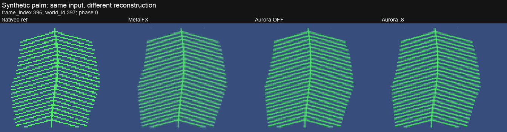

# Aurora reconstruction selection: not qualified for integration

Aurora's WGSL FSR3.1 port gives visibly clearer, steadier palm fronds than MetalFX in this shared perspective fixture. It does **not** yet justify full integration: both unsharpened and ordinary-sharpening arms still fail minimum recovered area and the 18/36-stopped-world response bounds. No cost comparison, production change, viewer build or DMG follows. PPD-610 remains unresolved.

## Algorithm and common input

This evaluates [Aurora](https://github.com/Aurora-Viewer/Aurora-Viewer/blob/ee458fbf1d95e98c5b3a55c0027a523bb28d7e7f/crates/aurora-render/src/fsr.rs) at`ee458fbf1d95e98c5b3a55c0027a523bb28d7e7f`: its WGSL port of the FSR3.1 upscaler from FidelityFX SDK 1.1.4, not an AMD-native SDK binary or frame generation. The documented port uses f32/fullscreen fragment passes and per-level pyramids. The evaluator uses the actual Apple M1 Max Metal backend; it is not a proposed replacement application backend.

One new production-renderer PBR MASK palm supplies the **same**256×128 linear-HDR color, reverse-Z perspective depth, motion and unblended before/after color to all algorithms, producing384×192 output. Near plane 0.1m, palm 2m and background 4m give valid perspective reconstruction; all forward BLEND is removed, composition marker 0 and exposure 1. No algorithm receives a quality/resolution reduction. Old orthographic results remain separate and are not used as MetalFX scores in this comparison.

The authored palm footprint/material is preserved: its 96×96native-reference cell is bit-identical to the earlier setup, with zero silhouette-mask differences. This is setup verification only. The new MetalFX run independently reproduces four original palm failures, satisfying the comparison gate.

Independent raw-input audit finds zero raster mismatches over 1,864,018 checked centers in the corrective882 input frames. Negating jitterY produces31,773 mismatches. Covered camera fallback agrees with explicit motion within8.71e−5 input pixels; depth values are0(clear),.025(background) and.05(palm). Actual arrays/matrices, not preference labels, establish the conventions. See [input audit](media/aurora-reconstruction-20261126/metrics/warm360-input-and-metalfx-maturity.json).

## Preliminary reference problem and one fixed correction

The initial144 main/54 reference-world study used36 warm-up worlds. Aurora's independent reference still changed by approximately.00706/.00772 RGB in the stop-scoring region between matching phases in its last two cycles; large stop-reference errors could not honestly be called motion ghosting.

Before the corrective capture, one fixed 360-world warm-up was declared for **all three arms**, without changing source algorithms, policy or quality bounds. The later JSON receipt records its actual 12:56:17 serialization time rather than pretending to be a pre-generation receipt. The short study remains retained as preliminary evidence. No further warm-up extension or parameter sweep followed.

The final main histories contain468 worlds:360 warm+54stationary+18 moving+36 stopped. Separate final-camera reference histories contain414 worlds; the last full phase cycle is indices 396–413. Stationary scoring uses indices 360–413, motion414–431 and stop 432–467. Frame indices are zero-based; actual world IDs are index+1. Stop 18/36 samples use frame indices 449/467(world IDs 450/468), phase 17 and each algorithm's own reference index 413.

Final phase-matched reference drift in the stop domain is only.0000202/.0000409/.0000475 for MetalFX/Aurora None/ordinary. It is far smaller than the retained stop errors. This supports the finite-window response comparison; it is not a claim of infinite-history convergence. [Maturity audit](media/aurora-reconstruction-20261126/metrics/warm360-reference-maturity.json).

## Final quality result

All original thresholds remain unchanged. Values use one portable float32-pixel/double-accumulation reducer; [exact JSON](media/aurora-reconstruction-20261126/metrics/comparison.json) and the [C++ baseline export](media/aurora-reconstruction-20261126/metrics/metalfx-cpp-corrective.json) preserve precision/provenance. C++/offline differences are only floating accumulation rounding and change no classification.

| Metric | MetalFX | Aurora RCAS None | Aurora ordinary0.8 | Original requirement |
|---|---:|---:|---:|---:|
| Mean edge-band change |.00432862|.00086731|.00094805|≤1/255|
| Minimum recovered recall |.877865|.936028|.958572|≥.90|
| Minimum recovered area |.745180|.821401|.832826|≥.85|
| Output edge energy |.209369|.232006|.252639|≥.163276|
| Foreground green contrast retention |74.66399%|82.01127%|82.09057%|descriptive|
| Stop 18phase-matched RGB error |.00828879|.01588627|.01693322|≤1/255|
| Stop 36phase-matched RGB error |.00325456|.01231943|.01305086|≤1/255|
| Stop 18old-history fraction |.0004192|.0003371|.0005733|≤.02|
| Stop 36old-history fraction |.0002290|.0000756|.0002304|≤.02|

Contrast retention is the mean linear-green excess over known background in the 84×84 output ROI divided by the corresponding56×56 actual input mean excess: `mean(G_output-G_background)/mean(G_input-G_background)`. Its denominator is the common actual input, not Native or a geometry count; it is not an added acceptance bound.

Aurora substantially reduces stationary variation and improves recall/detail. Both arms nevertheless miss area and both stopped-world response bounds. Sharpening strengthens contours without restoring enough recovered area. Low old-history residue and inspection of selected motion frames do **not** show a large persistent old-palm trail; the remaining discrepancy is detail/response settling relative to a mature same-view reference, not proof of ghosting.

Recovered area is a color/coverage proxy, not a missing-geometric-leaf count. Native0 is a binary detail reference, not an exact anti-aliased image oracle. Other original precision, coverage-change, native-error and detail guards remain in the JSON; no failing bound was relaxed to favor either algorithm.

New halo/overshoot/local-trail indicators were frozen as **review diagnostics**, not invented hard quality gates. Peak channel excursion beyond recorded foreground/background range is.25927/.00195/.11768 for MetalFX/None/ordinary. All have zero tested pixels beyond the two-pixel silhouette band above the 2/255background-residual review level. These describe this authored scene; they do not establish universal halo or transparency behavior.

## Activation, media and disposition

RCAS None actually omits the pass; internal/final RGB differences at frame 0 are zero. Ordinary actually dispatches RCAS at the upstream0.8setting and changes 143,473 main/143,974 reference RGB components at frame 0. It is not`Some(0)` mislabeled as off. Four independent complete processes have468/414 frames and one reset per stream. Five Rust/Naga tests and dedicated actual-device API/GPU adapter checks pass, including stationary identity, both-axis camera fallback, explicit motion/depth packing and zero generated reactivity. [Activation proof](media/aurora-reconstruction-20261126/metrics/activation.json).

The selected PNGs preserve native output pixels or nearest-neighbor enlargement. Both [stationary](media/aurora-reconstruction-20261126/visuals/stationary-matched.mp4) and [move-stop](media/aurora-reconstruction-20261126/visuals/move-stop-matched.mp4) clips show54matched output worlds; MP4/YUV420is a compatibility preview, with fixed common gamma export and no extra sharpening/normalization. Playback12 frames/s is inspection timing, **not viewer throughput**. [Source/frame hashes](media/aurora-reconstruction-20261126/visuals/source-receipt.json) and raw float arrays remain authoritative. Selected public media is synthetic and contains no account/scene data.

The result is a promising stationary/detail improvement but an **unqualified algorithm selection** under the unchanged target. Do not integrate it or infer a performance win. Cost was deliberately not measured after the quality gate failed. Native/Spatial remain available; no production preferences or shipping rendering path changed. No additional variant or broader renderer project is started by this handoff.

## Reproduction and limits

The isolated worktree/branch is`codex/aurora-reconstruction-evaluation-20261126`, parent`86a7654fb172c47ed9016e5d9c771aa4c06753f3`; normal Temporal/Spatial/usual branches are preserved. Harness and compiler/dependency pins live under [tools/metal/aurora-evaluation](../../../tools/metal/aurora-evaluation/). The C++ producer uses Apple clang 21.0.0(`clang-2100.1.1.101`), SDK 26.5 and macOS 26.5.2. Actual runtime records Rust 1.99.0`b940084d7`, wgpu`6c13013b3f9c8a7e45154d45d120ada0cbe55a23`; analysis pins NumPy 2.4.3. Exact executable/source/runtime hashes are retained in evaluation receipts.

The [offline reducer](../../../tools/metal/aurora-evaluation/analysis/README.md) accepts manifest/output paths, preserves original bounds and own-phase references, rejects missing histories and runs without a GPU. Its10 independent mathematical/completeness tests pass. The repository tool suite passes195 tests with one skip using the configured private PyYAML environment; an initial missing-PyYAML import failure is preserved separately.

Full synthetic input/output arrays, the short preliminary results and corrective receipts remain private under`artifacts/metal/aurora-evaluation-20261126/`. Only selected synthetic media and compact metrics/audits are versioned here. This one opaque MASK/camera-motion case does not qualify avatars, real foliage textures, transparency, water, full-view image quality or FPS.
