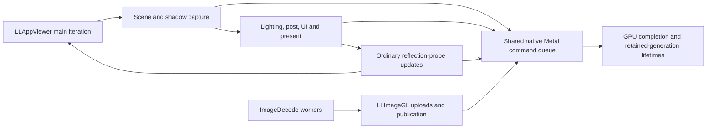

# G2–G5 busy-club profile — 2026-11-14

The current candidate has not demonstrated the intended viewer performance gain.
It presented17.77 FPS against 20.36 FPS in repaired G1, at the same logged render
size and saved visual settings. Its serial source preparation has substantial
cost, and the gated opaque indirect optimization recorded no successful
execution in the periodic counter window. This is a real online-engine workload
that the viewer must handle; world variation is evidence to quantify, not a
reason to disregard the slower experience. This assessment is PPD-110.

## Capture and comparison method

Owner manually started staged Alchemy Metal Alpha G2G5, 26.4.0.68995/PID19459,
arrived at the club and explicitly requested five-minute profiling. Before
attachment, process path and executable SHA256 were verified:
`96dcc743c9bfdd471984dd7843639137eeb1c4c3eb77dfd722e232ce6124e2ae`, compiled
source `6baeb0340a1ddeb89aa265a1a64321ad1e0cd57a`.

Instruments `Game Performance Overview`, 5m attach, run 1 recorded
08: 00: 41.550–08: 05: 43.895UTC, **302.345784 s**, end reason `Time limit reached`,
exit0. Recorder wall time498.799 s includes final symbol processing; it is not
an eight-minute measurement. No agent launch, camera or setting change occurred.
Owner normal quit after measurement was explicitly permitted; later process
absence is not a crash observation. No further live capture is running.

Reference is repaired native G1, source `fef1e756fd`, version 26.4.0.68991,
301.864885 s on the same M1 Max with 64 GiB.420 saved visual controls match across G1 and
current during/post-session snapshots, with none missing. Actual published
surfaces match **3456×2168**, in 62G1 and54 current interval messages. The earlier
empty current surface list was a parser miss, repaired by using the existing
`size=` log format. Individual offscreen target dimensions remain uncensused.

The live input is quantified below rather than assumed identical. Raw CPU
samples, Overview buckets and periodic work counters have different sampling
windows; normalized values are estimates, not exact per-frame correlated events.
The coarse Overview tables cannot supply frame-time p95; both individual-frame
tables are empty. GPU command spans can overlap and are not GPU busy time.

## Whole-viewer outcome

| Whole interval | Repaired G1 | G2–G5 | Change |
|---|---:|---:|---:|
| Presented FPS |20.364|17.773|−12.72%|
| Associated display interval |49.135 ms|56.385 ms|+14.76%|
| Associated GPU command span |85.394 ms|87.220 ms|+2.14%|
| Command buffers/presented frame |23.882|32.842|+37.52%|

Last60 s FPS20.113→17.925 (−10.88%): the whole-run difference is not explained
solely by the first seconds. Thermals are nominal throughout 302.346 s. Each
trace has one target process and one CAMetalLayer. The command-count result is
not duplicate-layer accounting: its alternative weighting agrees. Estimated
associated command rate also rises 486.79→583.70/s (+19.91%); the extra commands
per frame are not solely a consequence of fewer frames.

This does not assign the entire FPS difference to one change. It does establish
that passing the headless mechanism gates did not establish a successful
performance upgrade for this online workload. The architectural performance
objective remains unmet.

## Serial frame budget and actual work

CPU values below are sampled Running CPU time divided by estimated presented
frames. They are amortized costs, not frame-matched critical-path timings.
Parent/child categories overlap and must not be summed.

| Approximate main-thread CPU ms/present | G1 | G2–G5 |
|---|---:|---:|
| Entire main thread |33.97|49.30|
| Sun/shadow owner |15.50|21.86|
| Shadow source capture |2.22|7.34|
| Native shadow render/preparation |5.51|7.76|
| Main texture update/publication |0.99|4.39|
| Native G-buffer |2.83|3.97|
| Native post |3.10|4.02|
| State/post sorting |7.77|6.88|

Main Running weight is 264.914 CPU-s/302.346 s, 87.62% of one core, versus
208.812/301.865 s, 69.17%. The current process averages about3.28 sampled CPU core
equivalents, with about2.08 in six ImageDecode workers. These are CPU-work
estimates, not proof of which physical Apple core ran a thread or GPU saturation.

The new ownership boundary has positively observed main-thread bookkeeping:
`shadowSourceKey`7.525 CPU-s (~1.40 ms/present), source cache5.625 s (~1.05 ms),
and aggregate source/palette leases7.282 s (~1.36 ms). Keep these categories
separate; they are not an independently additive frame-time saving. Source
record sealing itself is only 0.641 CPU-s. The substantial cost is repeated
lookup/key/ownership handling, not simply constructing an immutable record.
Matrix preparation is only 0.495 CPU-s (about0.09 ms/present); adding finer matrix
jobs would target a small fraction of this serial cost. Exclusive copy/move
leaf cost rises 1.69→3.18 ms/present, but copied bytes and their producer breakdown
are not measured. Unified memory does not make these CPU copies free.

The periodic numeric census supplies the workload context:

| Work per estimated presented frame | G1 | G2–G5 | Change |
|---|---:|---:|---:|
| Main shadow source admissions |6547.72|8482.10|+29.54%|
| Probe shadow source admissions |603.35|755.78|+25.26%|
| Main G-buffer buffer binds |1040.48|1641.93|+57.81%|
| Probe G-buffer buffer binds |143.31|238.29|+66.28%|
| Native texture creations |6.97|16.22|+132.76%|
| Native buffer creations |217.99|256.26|+17.56%|

More work explains part of the higher cost and identifies scaling requirements;
it does not make every increase an implementation defect. For example, buffer
creation rate rises only 2.39% per second, and G-buffer binding work also rises
substantially: treating all extra driver time as a new per-call slowdown would
be incorrect. Conversely, source capture cost/present rises 231% while main
source admissions rise29.5%; the new serial boundary deserves direct scrutiny.
Material/rigged family composition is not constant, so that is a strong target,
not an isolated causal benchmark of the cache algorithm.

**The accepted opaque indirect speedup did not execute in the logged census.**
Main/probe generic indirect prepared/executed/run deltas are all zero over the
monotonic periodic window. This covers successful opaque-only execution too:
`pipeline.cpp`2804–2813 logs `shadowIndirectStats()`, whose shared command pool
increments generic executions/executed_draws in
`almetalshadowindirect.mm`578–579; the selected static/rigged paths call that
same `execute` in `almetalworld.cpp`7864–7882. Separate opaque statistics are
unlogged. Eligibility histograms/fallback causes and possible resets outside
the sampled window remain unknown. Do not infer a single8192-input family from
8482 admissions summed over multiple views/families. Compact Dispatch activation
and source-cache hit/miss rates are not emitted by this run.

Consequently, lowering thresholds merely to activate the feature is not a valid
repair: smaller headless cases already failed net-cost gates. The execution
unit and persistence strategy must fit the actual shorter, fragmented runs.

## Streaming, residency and unified memory are frame work

Six ImageDecode workers consumed628.601 CPU-s versus 10.103 s in G1. Periodic
counters show56, 104 completed decodes over 296 s versus 453 over 298 s: 189.54 versus
1.52 requests/s. These are requests, not necessarily unique textures. Summed
concurrent decode wall is 632.526 versus 9.929 s; it is not frame latency. Average
wall per completed request is approximately11.27 versus 21.92 ms: this evidence
shows far more decode work, not an intrinsically slower codec per request.

The current scheduler stays at limit 6 with reason `backlog` in 57/57 samples;
normal 4/max 6 configuration is retained. Waiting peaks at 2508 requests and the
oldest sampled wait reaches4.64 s. G1 reports no waiting backlog. Main texture
update/publication also rises from 0.99 to4.39 ms/present. Rendering must remain
responsive while this normal online work occurs; merely demanding a quiet,
fully loaded world would miss the engine problem.

Current sampled discard bias varies1.0–3.029, versus fixed1.0 in G1.
System-low texture-pressure reason appears17/30 samples versus 0. Resident image
samples are lower (4928–7064 MiB versus 10775–11200 MiB),
while texture creation/destruction rates are higher. This combination requires
examining request/residency/publication churn and system-pressure decisions;
it does not prove a particular re-decode feedback loop. It also prevents
claiming pixel/texture-detail parity from matching saved presets alone.

Target-pool accounting rises 295.474→495.548 MiB (+200.074 MiB), at the same
published render size, with no logged pool evictions. It is not proved to be a
leak or resolution increase. Target role, size and retained lifetime census is
needed to distinguish extra offscreen work and overlapping resource lifetimes.

The new `LLImageGL` lease branch can allocate a replacement and preserve every
old mip before a partial update (`llimagegl.cpp`1590–1612). That adds potential
allocation/copy work within an existing upload command, not an unconditional
new command. Current counters do not measure COW bytes, leased-generation
retention or superseded requests, so its contribution remains a hypothesis.
Unified memory makes these lifetimes, copies and competing producers part of
one engine budget; shared storage alone does not remove them.

## The actual cross-system dependency problem

The source has separately controlled producers sharing one native queue:

`llappviewer.cpp`1585–1597 calls display, end-frame and then ordinary probe
update. Realtime probes may process all six faces; irradiance/radiance/SH
publication dependencies must remain intact (`llreflectionmapmanager.cpp`
802–825, 1620–1624). Worker uploads use burst batches and independent immediate
uploads (`llimagegl.cpp`106, 1817). Native legacy command buffers use the same
device queue (`almetaldevice.mm`602). Separate world/shadow admission bounds
therefore do not constitute aggregate admission for all frame producers.

The app/probe update ordering and worker commit policy are unchanged between
G1 and the candidate. Overview has no per-command/pass labels, so this graph
explains an interaction boundary to measure and improve, not the proved origin
of the extra commands. Whole-invocation batching was already measured slower;
coordinating dependencies does not mean merging everything into one command.

## Next engineering work and its acceptance criteria

1. **Make retained data amortize at the producer.** The current
   `LLPipeline::captureMetalShadowScene` rebuilds the source key, touches cache
   state and inserts aggregate owners on each admitted reference. Publish
   geometry/material/coverage generation changes at their real owners
   (`LLDrawInfo`/dirty spatial groups, `LLVertexBuffer`, `LLImageGL`); let main,
   probe and shadow views consume stable references plus per-view transforms and
   current pose. Preserve generation leases, alpha/UV semantics, query order
   and cancellation. Track cost per changed source and per consumed reference;
   a retained record that requires expensive rediscovery every view is not
   the completed ownership architecture.
2. **Treat streaming and residency as part of the interactive frame.** Correlate
   decode targets/completions, texture pressure, visible demand, native
   publication/COW bytes and retired generations. Coalesce superseded work and
   publish useful generations under an explicit frame/byte budget while keeping
   texture response and rendering quality observable. Avoid blanket worker
   reductions or more threads as substitutes for this accounting. New decode
   arrival is expected; avoid paying again for unnecessary intermediate states.
3. **Coordinate native work across main, probes and uploads.** Extend existing
   completion/admission ownership with producer/frame/dependency identities,
   required-resource readiness and aggregate pending bytes/commands. Preserve
   projectors, six-face probe semantics, lighting and CPU/GPU overlap. Select
   persistent packets/argument data that are useful for observed run sizes;
   rebuild only dirty inputs rather than forcing a2k-draw threshold or an extra
   GPU cull after CPU discovery. Metal 4 remains a measured capability choice.
4. **Accept changes on the complete live frame and work scaling.** Use actual
   per-frame wall p50/p95 and presented throughput, main/worker time, workload
   counts, resource bytes and texture-response latency across settled view,
   active streaming, camera traversal and probe/avatar-heavy intervals. Group
   observations by recorded workload/quality instead of demanding an identical
   online world. Keep image/lighting/projector correctness and dynamic texture
   detail visible. A faster helper or pass is supporting evidence; a worse full
   frame or persistent loading regression fails the engine change.

This is a concrete continuation of the Apple-first ownership architecture,
not a proposal to rewrite Second Life networking/inventory or replace the
native backend. It targets this fork's serial discovery, generation handling
and shared CPU/GPU work graph. The current5m recording supplies an adverse
assessment and specific next boundaries; no implementation fix, new capture,
viewer restart or push was performed during this analysis.

## Evidence and limits

Raw/private evidence root:
`artifacts/metal/g2g5-busy-club-profile-20261114-080031/`.
Key receipts: `recording.json`, `toc.xml`, `capture-verification.json`,
`gpu-export-receipts.json`, `gpu-analysis-receipt.json`, `gpu-g1-comparison.json`,
`gpu-command-rate-proof.json`, `cpu-export-root-receipt.json`,
`cpu-analysis-receipt.json`, `cpu-brief-findings.json`,
`cpu-whole-frame-brief.json`, `safe-workload-census.json`,
`saved-graphics-post-session-vs-g1.json` and private interval-log hashes.

The first sandboxed offline exports failed on Instruments cache permissions;
those receipts remain. Root CPU export succeeds0/31.917 s, 271, 352, 656B; one-pass
CPU analysis succeeds0/26.03 s.333DWARF object-analysis warnings are retained.
Observed main exclusive-leaf coverage includes1.410 CPU-s address-only (~0.532%),
0.002 s missing backtrace and5.800 s deduplicated leaf. Function absence alone is
not proof of no execution. No additional symbolication/profiling loop was run.

No private startup settings, credentials, avatar/region identities or raw log
lines were exposed in the report. Original G1 captures/apps and the compiled
candidate were preserved. Documentation changes do not change compiled6bae.
